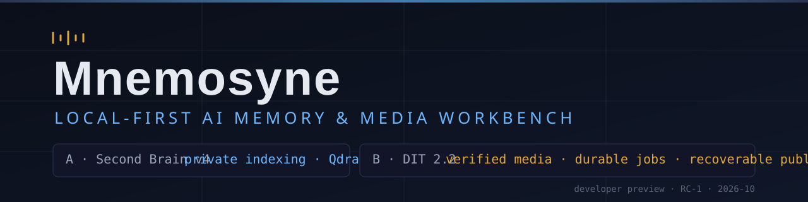
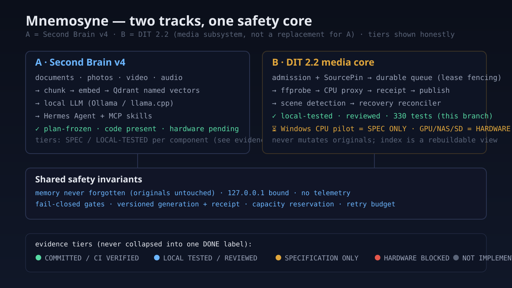

# Mnemosyne

> **Local-first AI Memory & Media Workbench.** A private second brain that indexes your notes, photos, videos, and audio on your own hardware — plus an experimental DIT 2.2 media subsystem that turns verified footage into recoverable, lease-fenced proxy pipelines. Developer Preview.



| | |
|---|---|
| **Status** | **Developer Preview (RC-1)** — core safety pipeline locally tested & reviewed; Windows pilot specified, not yet run |
| **License** | Code: [AGPL-3.0-or-later](LICENSE) · Docs & diagrams: [CC BY-SA 4.0](LICENSE-DOCS) · Third-party components keep their own licenses |
| **Powered by** | [Hermes Agent](https://github.com/NousResearch/hermes-agent) · Qdrant · Ollama/llama.cpp · FFmpeg · MCP |

---

## 1. What is Mnemosyne?

**Mnemosyne** (μνημοσύνη, "memory") is a local-first personal AI system. Everything runs on hardware you own: your documents, media, and models never leave your LAN, and there is no telemetry. The system is named after the Greek goddess of memory and after the long-term memory backend it is built on — the second brain *is* a memory system.

It has two interconnected product tracks:

## 2. Two product tracks

### Track A — Second Brain v4 (private document & media indexing)

- Private indexing of notes, photos, videos, audio, and PDFs.
- Local LLMs via [Ollama](https://ollama.com) (Metal) or [llama.cpp](https://github.com/ggerganov/llama.cpp) (Vulkan).
- [Qdrant](https://qdrant.tech) named vectors (`text_vec(768)` + `image_vec(512)`) — a rebuildable view over your files, never the source of truth.
- [Hermes Agent](https://github.com/NousResearch/hermes-agent) with [MCP](https://modelcontextprotocol.io) tool contracts and extensible skills (3 example skills ship in-repo).
- Local-first data ownership: originals are never moved or modified; the indexer only *suggests*.

> **Track A status:** the v4 plan is frozen with a SHA-256-verified 105-file archive snapshot, and the indexer/invariants/MCP skills are committed with CI-verified tests. The reference two-machine deployment (M1 + workstation) had not been physically stood up at plan time — live service integration remains hardware-pending. See the [implementation status matrix](docs/05_implementation-status-matrix.md) for exact tiers.

### Track B — Mnemosyne DIT 2.2 (media subsystem)

A Digital Imaging Technician-style core for moving image: not a replacement for Track A, but a media subsystem inside the project.

- **Source & replica catalog** — content-addressed assets, replica records, read-back evidence.
- **Verified media provenance** — Source admission gate (fail-closed) + **SourcePin** (content SHA256 re-hashed before *and after* encode; drift discards the artifact, never publishes).
- **Durable job queue** — SQLite, lease fencing, retry budget with exponential backoff.
- **FFprobe metadata** — read-only probing of FPS (incl. non-integer/VFR), timecode, HDR/log, audio layout; degrades to `unknown` rather than guessing.
- **CPU proxy generation** — H.264 browser/editor profiles, atomic staging → verify → receipt → publish.
- **Recoverable publication** — read-only recovery reconciler: `PUBLISHED` requires a complete generation, hash-matching artifact, *and* a valid receipt.
- **Scene detection** — content-diff (CPU) + fixed-interval, memory-bounded (frame-cap hard limit).
- **Safeguards** — memory guard, path isolation (symlink/traversal), capacity reservation, Windows-safe artifact naming.

> **Track B status (honest tiers):** P11.1/P12/P12.1/P12.2 are **LOCAL TESTED / REVIEWED** in this research branch — 330 tests passing, independent reviews complete, **not yet committed**. Windows CPU Pilot is **SPECIFICATION ONLY**; UNC/SMB, A770 GPU, and real camera media families are **HARDWARE BLOCKED / UNVERIFIED**. See the [status matrix](docs/05_implementation-status-matrix.md).

## 3. What problems does it solve?

- **Ownership** — search and process your media without uploading it; no SaaS, no telemetry.
- **Trust in pipelines** — a derived proxy is only ever `PUBLISHED` when artifact, hash, and receipt agree; a source change mid-pipeline can never masquerade as a trusted output.
- **Recoverability** — crash residue (zombie staging, orphan receipts, stale workers) is classified read-only with a safe action attached, never auto-deleted.
- **Reproducibility** — synthetic, generated test media drive the whole test battery; no real footage, no personal paths in evidence bundles.

## 4. Who is it for?

- Individual creators and editors who want a private, auditable media workflow.
- Developers building local-first AI on their own hardware (Hermes + MCP extensibility).
- DIT-style professionals who need provenance, receipts, and recoverable jobs more than speed.

## 5. Current capabilities (verified, by tier)

| Capability | Tier |
|---|---|
| v4 plan archive, 105/105 SHA-256 verified | COMMITTED |
| Indexer core + 7 invariants, named-vector test | COMMITTED / CI VERIFIED |
| 3 MCP skills (qdrant / filesystem / video-slice) | COMMITTED / CI VERIFIED |
| DIT 2.2 admission, fencing, proxy, recovery, P12.2 gates | LOCAL TESTED / REVIEWED (330 tests, uncommitted research branch) |
| Live two-machine deployment (M1 + workstation) | HARDWARE PENDING |
| Windows CPU Pilot (A770 box) | SPECIFICATION ONLY |
| GPU acceleration (QSV/OpenVINO) | HARDWARE BLOCKED |
| Real camera media families (Sony BRAW/XAVC, etc.) | UNVERIFIED (synthetic fixtures only) |
| Interactive developer TUI | NOT IMPLEMENTED (design concepts + labeled mockups) |

Full detail: [implementation status matrix](docs/05_implementation-status-matrix.md).

## 6. Architecture overview



- **Track A** (document/media → chunk → embed → Qdrant named vectors → local LLM → Hermes MCP).
- **Track B** (admission → SourcePin → durable queue → capacity gate → CPU encode → re-verify → atomic publish → read-only reconcile).
- **Shared invariants**: originals never mutated; index is a rebuildable view; fail-closed gates; local-only by default.

Media pipeline detail: [safety workflow diagram](docs/assets/rc1/media-pipeline-safety.svg) · [DIT 2.2 developer quick start](docs/dit22-quickstart.md).

## 7. Five-minute synthetic developer demo

No camera card, NAS, Windows, GPU, or cloud tokens needed — generated media, isolated temp dataset, CPU only. This runner maps 1:1 to the tested public APIs (each step is a real call, no invented commands):

```bash
# Python 3.10–3.12; ffmpeg + ffprobe on PATH
pip install -e .            # installs dev deps (pyproject)
python examples/dit22_synthetic_demo.py
```

Eight steps: source probe → CPU proxy → receipt verification → controlled safe failure → read-only recovery verdicts → editor proxy validation → CPU scene detection → Windows-safe naming + capacity gate. Machine-readable evidence (no absolute host paths, no credentials) lands in `demo_evidence_bundle.json`.

The demo is **MODULE-LEVEL**: it exercises the tested APIs separately; there is no single shipped end-to-end CLI yet (that is part of the next development phase).

## 8. System requirements & supported platforms

| Need | Requirement |
|---|---|
| Python | 3.10 – 3.12 (venv recommended) |
| Media tools | `ffmpeg` + `ffprobe` on PATH (CPU baseline; no GPU required) |
| OS | macOS (Apple Silicon / Intel) and Linux are exercised by tests; **Windows is specification-only** (CPU Pilot pending) |
| Track A services | Qdrant, Ollama or llama.cpp, Hermes Agent — see [Phase guides](docs/02_方案文檔/Phase_0_啟動手冊.md) |
| Memory | Scene detection is frame-capped (P12.1); long 4K workloads remain unvalidated |

## 9. Safety principles & permission boundaries

1. **Originals are truth.** The index is a derived, rebuildable view; nothing is auto-moved or auto-deleted.
2. **Fail-closed gates.** Admission, pin verification, lease fencing, capacity, and path isolation all deny on ambiguity.
3. **No cloud by default.** Everything is local and 100% on your hardware; the architecture *could* later add explicitly-enabled, opt-in providers, but none are configured or called in this release — and any such change is a separate, announced decision, not a hidden one.
4. **Honest status.** Hardware-blocked items are labeled as such; a synthetic test is never reported as a real-device PASS.
5. **15% free-space is advisory-only.** Low space stops *new* proxy/embedding jobs; it never triggers deletion of originals, music, or backups.

## 10. Developer TUI (design, clearly labeled)

An interactive developer TUI does **not** exist yet — the screens below are **CONCEPT MOCKUPS** from a documented design system, built from static fixture data, and never pass as a shipped feature. The synthetic demo output above (REAL EXECUTION) is the only terminal capture in this release, and it is reproducible: `python examples/dit22_synthetic_demo.py`.

Design system (6 screens, synthetic data only): [TUI design & mockup guide](docs/dit22-tui-design.md) · [mockup asset](docs/assets/rc1/tui-dashboard-concept.svg)

### Visual identity

Restrained engineering visual system (dark graphite / midnight navy foundation, cool blue for memory & indexing, warm amber for camera media & DIT processing, thin graph lines with media-timeline checksum marks). Editable SVG sources + PNG derivatives (via `rsvg-convert`) live in [`docs/assets/rc1/`](docs/assets/rc1/):

| Asset | Source (editable) | Derived PNG | Role |
|---|---|---|---|
| Hero banner | [mnemosyne-hero.svg](docs/assets/rc1/mnemosyne-hero.svg) | mnemosyne-hero.png | README landing (1280×320) |
| Social preview | [social-preview.svg](docs/assets/rc1/social-preview.svg) | social-preview.png | GitHub repo social-preview setting (1280×640, <1 MB) — upload via **repo Settings → Social preview** (manual, recorded below); until then the default repo card applies |
| Project icon | [mnemosyne-icon.svg](docs/assets/rc1/mnemosyne-icon.svg) | mnemosyne-icon.png | Square mark (1280×1280, scalable down) |
| Architecture overview | [architecture-overview.svg](docs/assets/rc1/architecture-overview.svg) | architecture-overview.png | Two tracks + shared safety core |
| TUI dashboard concept | [tui-dashboard-concept.svg](docs/assets/rc1/tui-dashboard-concept.svg) | tui-dashboard-concept.png | **CONCEPT MOCKUP** (DESIGN PREVIEW watermark in the artwork) |
| Media pipeline / safety workflow | [media-pipeline-safety.svg](docs/assets/rc1/media-pipeline-safety.svg) | media-pipeline-safety.png | Fail-closed pipeline, honest tiers |

> No asset is a screenshot of running software except the demo capture (REAL EXECUTION). None depicts fabricated operational status, benchmarks, or real footage. Visual QA of the rendered PNGs is marked **VISUAL_QA_PENDING** (automated vision review unavailable at preparation time); SVG sources are the editable truth and render deterministically.

## 11. Documentation index

- [`docs/00_index.md`](docs/00_index.md) — master TOC for the v4 plan artifacts.
- [Implementation status & evidence matrix](docs/05_implementation-status-matrix.md) — every component's honest tier.
- [DIT 2.2 developer quick start](docs/dit22-quickstart.md) — Track B, from clone to first proxy.
- [TUI design & mockups (DESIGN PREVIEW)](docs/dit22-tui-design.md).
- [DIT 2.2 engineering records](docs/engineering/P11.1-safety-integration-review.md) · [P4 integration contract audit](docs/engineering/P4-integration-contract-audit.md).
- [Windows CPU Pilot spec](docs/engineering/spec/Windows-CPU-pilot-A770.md) · [Windows workstation census spec](docs/engineering/spec/Windows-workstation-census.md).
- Troubleshooting & recovery: [restore drills](docs/06_備份與同步/還原演練.md) + the read-only recovery reconciler (Track B).
- [CONTRIBUTING](CONTRIBUTING.md) · [SECURITY](SECURITY.md) · [CODE OF CONDUCT](CODE_OF_CONDUCT.md).

## 12. Roadmap & limitations

- **Windows CPU Pilot** (A770 workstation, CPU-only by design) — spec complete, awaiting execution authorization.
- Committing the Track B safety layers (C1/C2/C3 atomic slices) — prepared, awaiting approval.
- GPU/QSV/OpenVINO validation — hardware-blocked, census-driven.
- P13 semantic segmentation — not started in this release.
- Durable limitations: UNC/SMB durability, power-loss, and real-camera media families are out of scope until physical evidence exists.

## 13. License & acknowledgments

- **Code**: [AGPL-3.0-or-later](LICENSE). **Docs/diagrams/eval sets**: [CC BY-SA 4.0](LICENSE-DOCS).
- **Third-party components retain their own licenses** — Hermes Agent (MIT), Qdrant (Apache-2.0), Ollama, llama.cpp (MIT), Open WebUI, Tailscale, PySceneDetect, and the Mnemosyne memory backend are all separate projects with their own terms; see the [component integration matrix](docs/02_方案文檔/架構B_開源組件整合表.md).
- Thanks to [Nous Research](https://nousresearch.com) (Hermes Agent), [Qdrant](https://qdrant.tech), and the open-source maintainers who make local-first AI possible.

---

*“Memory never forgotten. The original file is the source of truth; the index is a derived view.” — Track B adds: a published artifact is only trusted when artifact, hash, and receipt agree.*
